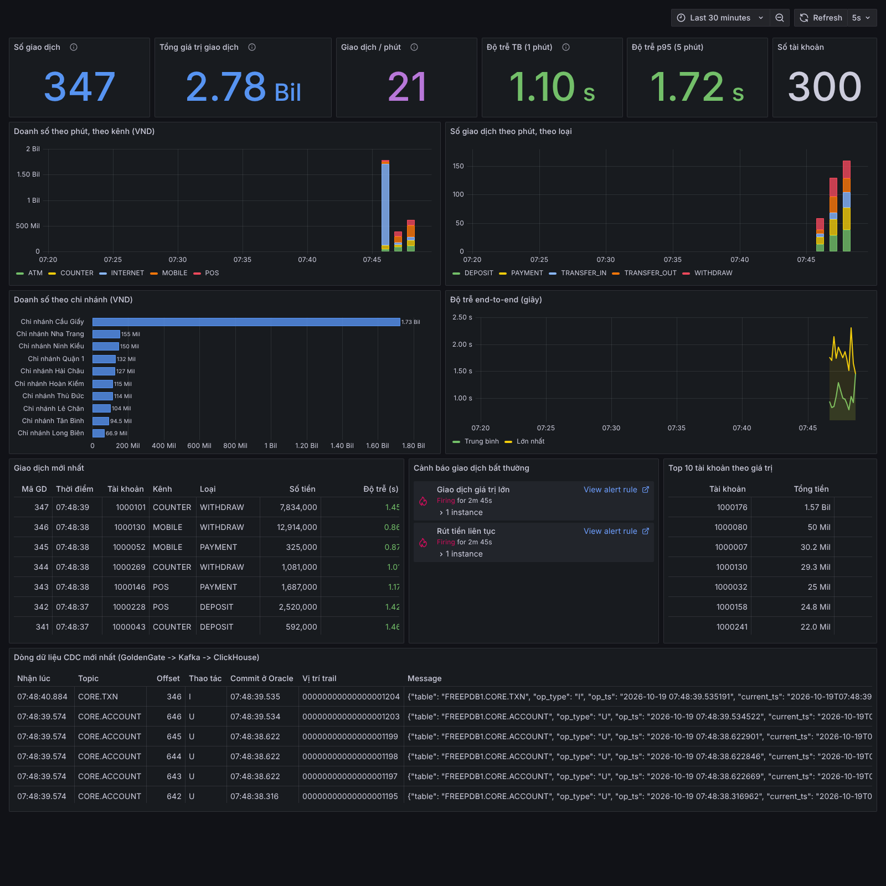

# Demo RTDP: giao dịch ngân hàng thời gian thực

Một giao dịch ghi vào core banking (Oracle) xuất hiện trên dashboard Grafana sau khoảng 1–2 giây, thay vì T+1.

```
 generator.py ──► Oracle 23ai Free ──► GoldenGate Extract ──► GoldenGate DAA ──► Kafka ──► ClickHouse ──► Grafana
 (sinh giao dịch)  schema CORE          (Integrated, trail ct)  (Kafka Handler)   CORE.*    Kafka engine   dashboard
                   ARCHIVELOG                                    JSON, mode=op     topic     + MV           + cảnh báo
```

Oracle, Kafka, ClickHouse và Grafana chạy bằng Docker Compose. GoldenGate dùng bản cài sẵn của bạn,
cấu hình mẫu ở thư mục `goldengate/`.



## 1. Yêu cầu máy

- Ubuntu 22.04/24.04, RAM 16 GB, ổ trống ≥ 40 GB
- Docker Engine + Docker Compose v2, Python 3.10+
- Lần chạy đầu cần Internet để tải image (~5 GB) và plugin ClickHouse cho Grafana

## 2. Khởi động hạ tầng

```bash
cd rtdp-demo
cp .env.example .env          # tuỳ chọn: đổi mật khẩu, địa chỉ
docker compose up -d
docker compose ps             # đợi rtdp-oracle chuyển sang (healthy), thường 1–2 phút
scripts/check.sh              # kiểm tra từng chặng
```

Khi Oracle khởi tạo lần đầu, script trong `oracle/setup/` tự chạy:

- bật ARCHIVELOG, FORCE LOGGING, supplemental log, `ENABLE_GOLDENGATE_REPLICATION=TRUE`, `streams_pool_size=256M`;
- tạo user GoldenGate `ggadmin` (trong PDB) và `c##ggadmin` (trong CDB), cấp quyền `OGG_CAPTURE`;
- tạo schema `CORE` gồm 4 bảng `BRANCH`, `CUSTOMER`, `ACCOUNT`, `TXN`.

| Thành phần | Địa chỉ | Tài khoản mặc định |
| --- | --- | --- |
| Oracle (PDB) | `localhost:1521/FREEPDB1` | `core/core`, `ggadmin/ggadmin`, CDB: `c##ggadmin/ggadmin` (service `FREE`) |
| Kafka | `localhost:9092` (từ máy host), `kafka:29092` (trong mạng docker) | — |
| ClickHouse | http://localhost:8123, native `localhost:9000` | `rtdp/rtdp` |
| Grafana | http://localhost:3000 | `admin/admin` (người xem ẩn danh được xem dashboard) |

## 3. Cấu hình GoldenGate

Các file đều có chỗ `<...>` cần thay theo bản cài (cổng, tên deployment, đường dẫn).

**3.1. Extract (GoldenGate for Oracle):** thư mục `goldengate/extract/`

1. Chép `EXTCORE.prm` vào thư mục tham số của deployment (`$OGG_ETC_HOME/conf/ogg/`).
2. Chạy `adminclient` rồi gõ `OBEY .../setup-extract.oby`. Script này tạo credential, chạy `ADD SCHEMATRANDATA CORE ALLCOLS`,
   đăng ký và khởi động Integrated Extract `EXTCORE` ghi ra trail `ct`.
3. Kiểm tra: `python generator/generator.py once`, sau đó `STATS EXTRACT EXTCORE` phải tăng.

**3.2. Replicat Kafka (GoldenGate DAA):** thư mục `goldengate/daa/`

1. Tải thư viện Kafka client: `$OGG_HOME/opt/DependencyDownloader/kafka.sh 3.8.1`.
2. Chép `RKAFKA.prm`, `kafka.props`, `custom_kafka_producer.properties` vào `$OGG_ETC_HOME/conf/ogg/` của deployment DAA,
   sửa `gg.classpath` và đường dẫn `property=` cho đúng.
3. Đưa trail `ct` sang DAA: dùng Distribution Path, hoặc trỏ đường dẫn tuyệt đối nếu hai bản cài cùng máy (xem chú thích trong `setup-daa.oby`).
4. `OBEY .../setup-daa.oby` để tạo và khởi động Replicat `RKAFKA`.
5. Bật **Auto Restart** cho Extract và Replicat (giao diện web: Managed Options; bản Classic: `AUTORESTART ER *, RETRIES 10, WAITMINUTES 1` trong `mgr.prm`).
   Cần bước này để ca TC05 (tắt/bật Kafka) tự phục hồi.
6. Kiểm tra: `scripts/check.sh`, số message ở các topic `CORE.*` phải tăng khi có giao dịch.

Định dạng message mà ClickHouse chờ đọc (Kafka Handler mặc định, `format=json`, `mode=op`):

```json
{"table":"FREEPDB1.CORE.TXN","op_type":"I","op_ts":"2026-10-17 03:00:00.123456","current_ts":"...","pos":"...",
 "after":{"TXN_ID":1,"ACCOUNT_ID":1000001,"AMOUNT":2500000,"CREATED_AT":"2026-10-17 03:00:00.120000", ...}}
```

> **Chưa có GoldenGate mà muốn thử phần sau Kafka?** Dùng script giả lập (chỉ để thử, demo thật thì tắt đi):
> `pip install confluent-kafka && python scripts/gg_simulator.py`. Script đọc Oracle định kỳ và gửi message
> cùng định dạng vào Kafka. Script không bắt được lệnh DELETE; ca TC03 thì dùng `--delete-txn <id>`.

## 4. Sinh dữ liệu

```bash
python3 -m venv .venv && . .venv/bin/activate
pip install -r generator/requirements.txt
set -a; . ./.env; set +a       # nếu có file .env

python generator/generator.py seed               # 10 chi nhánh, 200 khách hàng, 300 tài khoản
python generator/generator.py run --rate 3       # ~3 giao dịch/giây, Ctrl+C để dừng
```

**Chạy `seed` sau khi Extract đã chạy**, để dữ liệu gốc cũng đi qua GoldenGate. Nếu lỡ seed trước,
chạy `python generator/generator.py resync` để gửi lại toàn bộ.

Các lệnh khác: `once`, `anomaly`, `update`, `delete`, `stats`; xem `python generator/generator.py <lệnh> --help`.

Dashboard: http://localhost:3000/d/rtdp-realtime (tự làm mới mỗi 5 giây).

## 5. Kịch bản demo 10 phút

Trước giờ demo 30 phút: `docker compose up -d`, khởi động Extract/Replicat, `scripts/check.sh`,
chạy `generator.py run --rate 3` ở một terminal để dashboard đã có số liệu.

| Phút | Việc làm | Lệnh / màn hình |
| --- | --- | --- |
| 0–2 | Bài toán T+1 và kiến trúc | Sơ đồ ở đầu README |
| 2–4 | Một giao dịch thủ công | `python generator/generator.py once --amount 50000000 --wait`: in ra số giây đến ClickHouse; giao dịch hiện ở bảng "Giao dịch mới nhất" |
| 4–6 | Đi theo dòng dữ liệu | `STATS EXTRACT EXTCORE` / `STATS REPLICAT RKAFKA` → `scripts/check.sh` (offset Kafka) → panel "Dòng dữ liệu CDC mới nhất" |
| 6–8 | Giao dịch bất thường | `python generator/generator.py anomaly`: panel "Cảnh báo" bật đỏ trong ~10–30 giây |
| 8–10 | Đối soát, hỏi đáp | Dừng `run`, chạy `python generator/reconcile.py`: Oracle và ClickHouse khớp 100%; panel "Độ trễ end-to-end" |

Phương án dự phòng: quay sẵn video demo hoàn chỉnh.

## 6. Ca kiểm thử

| Mã | Cách chạy | Tiêu chí đạt |
| --- | --- | --- |
| TC01 | `generator.py once --wait` | In "Đã có ở ClickHouse sau x giây", x < 10 |
| TC02 | `generator.py update --account-id 1000001 --balance 123456789` | `SELECT balance FROM rtdp.v_account WHERE account_id=1000001` ra giá trị mới |
| TC03 | `generator.py delete` (xoá giao dịch mới nhất) | Message `op_type = D` trong `rtdp.cdc_events`; giao dịch biến mất khỏi `rtdp.v_txn` |
| TC04 | Dừng `run`, chạy `reconcile.py` | "ĐẠT - Oracle và ClickHouse khớp 100%" |
| TC05 | Đang `run`: `docker stop rtdp-kafka`, đợi 20 giây, `docker start rtdp-kafka`, rồi `reconcile.py` | Khớp 100% (Replicat phải bật Auto Restart) |
| TC06 | `generator.py anomaly` | 2 cảnh báo "Rút tiền liên tục", "Giao dịch giá trị lớn" bật trong vòng 1 phút |
| TC07 | `generator.py run --rate 5 --duration 1800`, song song `docker stats` | RAM toàn máy < 13 GB, không container nào bị kill |

Kết quả chạy thử (không có GoldenGate, dùng `gg_simulator.py`): TC01 khoảng 0,6–1,3 giây; TC02–TC06 đạt.
Lúc đó Oracle dùng 2,35 GB, ClickHouse 0,42 GB, Kafka 0,41 GB, Grafana 85 MB.

## 7. Ngưỡng cảnh báo

Ngưỡng nằm trong bảng ClickHouse `rtdp.alert_config` và có hiệu lực ở lần đánh giá kế tiếp (10 giây):

```bash
scripts/set-threshold.sh                          # xem ngưỡng hiện tại
scripts/set-threshold.sh withdraw_count 5         # cảnh báo khi rút > 5 lần ...
scripts/set-threshold.sh withdraw_window_min 5    # ... trong 5 phút
scripts/set-threshold.sh large_amount 1000000000  # giao dịch > 1 tỷ VND
```

Lệnh `generator.py anomaly` tự đọc ngưỡng, nên đợt bất thường luôn vượt ngưỡng.

## 8. Thiết kế phía ClickHouse

- Mỗi topic có một bảng `Kafka` engine (`q_*`). Materialized view parse JSON vào bảng đích, dùng ảnh `after` cho insert/update và `before` cho delete.
- Bảng đích dùng `ReplacingMergeTree(version, is_deleted)`. Update/delete được áp dụng theo khoá chính, và message nhận trùng
  (Kafka giao "ít nhất một lần", ví dụ khi Kafka khởi động lại) không làm lệch số liệu.
  Dashboard và đối soát đọc qua các view `v_*` (đã `FINAL`, bỏ dòng đã xoá).
- `kafka_flush_interval_ms = 1000`: ClickHouse ghi mỗi giây; mặc định là 7,5 giây.
- `rtdp.cdc_events` lưu mọi message thô trong 3 ngày, để trình diễn và gỡ lỗi.
- Độ trễ end-to-end = `ingested_at` (lúc vào ClickHouse) − `CREATED_AT` (Oracle ghi theo giờ UTC).

## 9. Xử lý sự cố

| Triệu chứng | Nguyên nhân thường gặp | Xử lý |
| --- | --- | --- |
| Extract không bắt được thay đổi | Chưa chạy `ADD SCHEMATRANDATA` hoặc Extract đăng ký sai PDB | `INFO SCHEMATRANDATA CORE`; kiểm tra alias trỏ `FREEPDB1` |
| Replicat báo lỗi kết nối Kafka | Sai `bootstrap.servers` | Từ máy host dùng `localhost:9092`; trong container docker dùng `kafka:29092`. Máy khác: đặt `KAFKA_EXTERNAL_HOST` trong `.env` |
| Topic có message nhưng ClickHouse trống | Tên topic khác `CORE.*` hoặc JSON khác mẫu | `scripts/check.sh`; đọc thử: `docker exec rtdp-kafka /opt/kafka/bin/kafka-console-consumer.sh --bootstrap-server kafka:29092 --topic CORE.TXN --from-beginning --max-messages 1` |
| Dashboard thiếu tên chi nhánh / đối soát lệch ở branch, account | Seed trước khi Extract chạy | `generator.py resync` |
| Grafana không có datasource ClickHouse | Không tải được plugin (mất mạng lần đầu) | Có mạng rồi `docker compose restart grafana` |
| Container bị kill | Hết RAM | `docker stats`; giảm heap Java của GoldenGate |
| Ổ đầy dần | Archive log của Oracle | `docker exec -it rtdp-oracle rman target /` → `DELETE NOPROMPT ARCHIVELOG ALL COMPLETED BEFORE 'SYSDATE-1';` (chỉ khi Extract đã đọc qua) |

## 10. Dừng và dọn dẹp

```bash
docker compose stop        # dừng, giữ dữ liệu
docker compose down        # xoá container, giữ volume dữ liệu
docker compose down -v     # xoá cả dữ liệu (Oracle khởi tạo lại từ đầu lần sau)
```

Sau `down -v`, hãy xoá và tạo lại Extract/Replicat, vì checkpoint GoldenGate còn trỏ vào database cũ.

## Khác biệt so với tài liệu triển khai ban đầu

- Image Oracle: `gvenzl/oracle-free:23` (Oracle Database 23ai Free trên Docker Hub, tải không cần đăng nhập, hỗ trợ script khởi tạo).
- Topic theo `${schemaName}.${tableName}`: `CORE.TXN`, `CORE.ACCOUNT`, `CORE.CUSTOMER`, `CORE.BRANCH` (thêm 2 bảng danh mục để hiển thị tên chi nhánh).
- ClickHouse dùng `ReplacingMergeTree` + view `FINAL` thay cho `MergeTree`, để TC02/TC03/TC04 đúng. Bảng tổng hợp theo phút
  được thay bằng truy vấn trực tiếp trên view, vì dữ liệu demo nhỏ, luôn đúng khi có update/delete.
- Ngưỡng cảnh báo cấu hình được, không cần sửa file.
